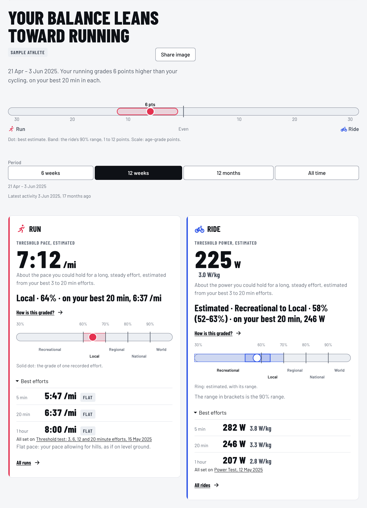
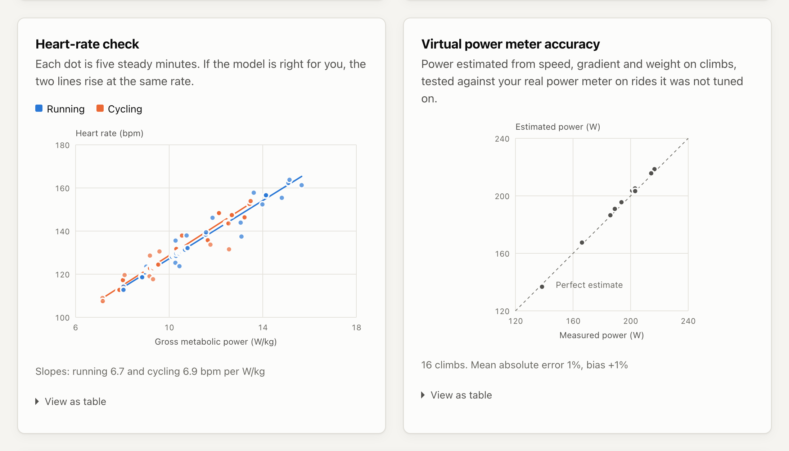

# RunningCyclingAnalysis

How do your running and cycling energy estimates compare? Watts on the bike and pace on the run
cannot be compared directly. This app converts both into an **energy rate** (gross metabolic power in
watts of energy burned per kilogram of body weight, W/kg), compares your best efforts in each sport,
grades each one against the standard for your age and sex, and reports the gap with a model range.
This estimates energy use; it does not rank sporting ability.

[Open the live app](https://rca-api.nutritioncoachapp.workers.dev) ·
[Reviews](docs/REVIEWS.md) · [Operations and verification](docs/PRODUCTION.md)

The current live version was deployed with the Wrangler CLI. This README does not record which commit
or version is live; [docs/PRODUCTION.md](docs/PRODUCTION.md) explains how to check it. The limits and
operations described below reflect the current source, not necessarily the live deployment.

Analysis always runs in your browser: activity files are parsed and analysed on your device. An
account is optional. With one, your profile and activity library are stored on Cloudflare so they
follow you between devices (see [Accounts and sync](#what-it-does)). Without one, the activity
summaries are kept in your browser's IndexedDB storage so your results survive a reload; nothing is
sent to Cloudflare, and Remove all my activities removes them (on Profile, when signed out).

<p align="center">
  <picture>
    <source media="(prefers-color-scheme: dark)" srcset="docs/screenshot-dark.png" />
    
  </picture>
</p>

## Where this is going

The app is becoming a platform that estimates an athlete's evolving performance in running, cycling,
weight training and swimming from the activity files and simple logs people already have. Each sport
gets its own model and units. Results always separate what was demonstrated from what is estimated, and
they state the uncertainty and the evidence still missing. The plan is in
[docs/VISION.md](docs/VISION.md).

## What it does

- **Age-graded levels and balance.** With your age, sex and weight, each sport's best 20 minute
  effort is graded against the USATF road standards for your age and sex, and shown as a level such
  as Local or Regional. The balance is the gap between the two grades, in points, drawn with the
  ride's 90% range. A ride's grade needs your weight and is graded through its running equivalent.
  With grades, the energy comparison below is their cross-check; without an age and sex, the balance
  uses the energy comparison instead. A level is not a ranking.
- **Reads FIT, GPX and TCX files** from Garmin, Wahoo, Strava and similar devices, singly, gzipped,
  or inside a Strava or Garmin Connect account-export zip. A Garmin export is read by the layout
  described in guides and forums, and has been tested on synthetic zips only. GPX files never carry
  device speed, and TCX files only sometimes do. Where a file has no speed, speed is worked out
  from distance or from GPS positions.
  Short best efforts from GPS-only files, under about 30 seconds, are less reliable than from FIT.
  FIT preference applies when duplicate files are imported together. A saved activity keeps its
  original file hash; to replace it with a different file, delete the saved activity and import the
  preferred file again.
- **One unit for both sports.** Cycling power is divided by gross efficiency. Running speed and
  gradient go through the Minetti et al. (2002) energy-cost-of-running curve, raised by 0.3 J/kg/m
  so that flat running costs 3.9 J/kg/m. Both become W/kg.
- **Uncertainty, not a single number.** Efficiency and running economy differ between people and
  cannot be read from a file, so they are sampled from population priors and the result is a 90%
  range.
- **Heart-rate cross-check.** Under the assumption that heart rate responds similarly to energy
  use in both sports, the slope ratio can adjust the population priors. Weights are normalised in
  log space. If their effective sample size is below 20 draws or 1% of the simulation, the app keeps
  the population-based result and explains that the adjustment was unsupported. This numerical
  diagnostic does not validate the physiological assumptions.
- **Virtual power meter.** For rides without a power meter, power on climbs is estimated from
  speed, gradient and mass. The bike model is calibrated on rides that do have a power meter and
  scored leave-one-ride-out, so the accuracy figure is out-of-sample.
- **Effort context.** Heart rate below the highest sustained value on file can suggest missing
  harder efforts. Being near that recorded value does not establish that an effort was all-out.
- **Period filter.** Fitness changes, so the comparison covers the last 12 weeks by default. The
  period control also offers the last 6 weeks, the last 12 months or all time, each counted back from
  your newest activity.
- **Data-quality checks.** Sensor dropouts, spikes and physiologically implausible readings (for
  example 103 bpm while holding 322 W) are detected, excluded and listed per activity.
- **Dated settings and zones.** On Profile you can date a weight, a max heart rate or a threshold.
  Each activity uses the setting in effect on its own day, and zones are cut from them by published
  schemes, or estimated from your activities when none is entered.
- **Time in zones.** How long you spent in each heart-rate, power or run-pace zone over a period or
  a stretch you select, by each day's zones.
- **Activity detail.** Each activity shows its timelines, laps and suggested intervals, splits on
  moving time, how your reps held up, and time at each pace, power or heart rate, read from a
  recording kept on your device. Runs at walking pace are marked and left out of run analysis.
- **Durability and drift.** Your best 5 and 20 minute output late in long sessions, and how output
  per heart rate drifts across a steady effort of an hour or more.
- **Accounts and sync.** Sign in with Google to keep your profile and activity library on
  Cloudflare. Per-activity digests are stored in D1; original files are not kept by default.
  Users can opt in to R2 retention subject to per-user and application-wide limits. Direct bucket
  access outside the app is not covered by those limits and could incur charges. Each user sees
  only their own data. Account deletion immediately blocks access and starts cleanup; if file
  deletion is interrupted, a tombstone lets retries and scheduled maintenance finish it. The
  [privacy policy](https://rca-api.nutritioncoachapp.workers.dev/privacy.html) lists exactly what is
  stored.

The system design is described in [docs/ARCHITECTURE.md](docs/ARCHITECTURE.md), and planned work is
in [docs/ROADMAP.md](docs/ROADMAP.md). Operational limits, release gates and remaining launch
evidence are in [docs/PRODUCTION.md](docs/PRODUCTION.md); the local benchmark is in
[docs/PERFORMANCE.md](docs/PERFORMANCE.md). Service and storage limits are in
[apps/api/LIMITS.md](apps/api/LIMITS.md). Engineering rules are in
[docs/ENGINEERING.md](docs/ENGINEERING.md).

## The model

| Step             | Formula                                                                                     |
| ---------------- | ------------------------------------------------------------------------------------------- |
| Cycling          | `M = P / (GE × mass)`, with `GE ~ N(0.215, 0.015)`                                          |
| Running          | `M = rest + s × C(grade) × speed`, with `C` from Minetti 2002 plus 0.3 and `s ~ N(1, 0.08)` |
| Comparison       | `ratio(t) = M_run(t) / M_ride(t)` over 4,000 seeded Monte Carlo draws                       |
| Heart-rate check | `κ = slope_ride / slope_run` of heart rate against `M`, on 5-minute block means             |
| Update           | each draw is weighted by the likelihood of the observed `κ` (importance sampling)           |
| Virtual power    | `P = (m g (sin θ + Crr cos θ) v + ½ ρ CdA v³ + m a v) / η`, climbs only                     |

`M` is gross metabolic power in W/kg, `P` is mechanical power in W, and `rest` is 1.22 W/kg.



The heart-rate check plots each five-minute block for both sports, and the virtual power meter is
scored only on rides it was not tuned on.

## Validation

The repository includes a deterministic simulator (`packages/core/src/synthetic`) that generates
physically consistent activities for an athlete whose true efficiency, running economy and
critical power are known. The integration tests in `packages/core/src/pipeline.test.ts` run the
whole pipeline on that data and assert that it recovers the simulated parameters. These tests
validate implementation consistency, not accuracy or interval coverage on real athletes. The
importers are checked against real device files in [docs/validation/devices.md](docs/validation/devices.md) and [docs/validation/gpx-tcx.md](docs/validation/gpx-tcx.md).

## Limits

- Best-effort curves are only as good as the hardest efforts on file.
- Heart-rate blocks enter the regression only when their power is at or below each sport's critical
  power, because heart rate stops rising linearly with power above it. Blocks are selected on power,
  not heart rate, to avoid directly truncating the dependent variable. Other sources of bias remain. The first 10 minutes of each activity are
  skipped as warm-up.
- The heart-rate check assumes heart rate maps to energy rate the same way in both sports. A
  fixed model-discrepancy term allows some disagreement, but its calibration has not been validated.
- The 90% model range samples efficiency and running economy; it does not include every sensor,
  virtual-power, terrain, effort-coverage or physiological error.
- Heat, altitude, fatigue and cardiac drift shift heart rate and are not modelled.
- Treadmill and indoor activities have no gradient.
- Virtual power is used on climbs only, because wind and drafting dominate on flat roads.

## Development

Requires Node 22.

```bash
npm install
npm run dev
```

| Command                           | What it does                                                                               |
| --------------------------------- | ------------------------------------------------------------------------------------------ |
| `npm run dev`                     | Web app dev server (Vite)                                                                  |
| `npm run dev:api`                 | Local API Worker on port 8787 (`wrangler dev`)                                             |
| `npm run build`                   | Production build of the web app into `apps/web/dist`                                       |
| `npm test`                        | Unit and component tests across all packages (Vitest)                                      |
| `npm run test:coverage`           | Same, with coverage thresholds                                                             |
| `npm run e2e`                     | Playwright tests against the production build; run `npm run build` first                   |
| `npm run check`                   | Format check, lint, typecheck, tests with coverage, deploy-config and ops tests, and build |
| `npm run test:perf`               | Wall-clock and heap budgets for `@rca/core` and `@rca/web` (`vitest.perf.config.ts`)       |
| `npm run smoke:prod`              | Read-only checks of the live origin; add `-- --expect-sha <sha>` after a release           |
| `npm run fixtures -w @rca/web`    | Regenerates the deterministic e2e fixtures (FIT, GPX, TCX and the Strava zip)              |
| `npm run screenshots -w @rca/web` | Builds, then regenerates the README screenshots in `docs/`                                 |

To run two e2e suites at once (for example from two worktrees, not one checkout), give each its own
pair of free ports: `E2E_WEB_PORT` (default 4319, the preview server) and `E2E_API_PORT` (default 8787,
`wrangler dev`). Each API port keeps its own local D1 state in `apps/api/.wrangler/e2e-state-<port>`.
The defaults are what CI uses; `apps/web/e2e/ports.ts` holds them.

### Layout

npm workspaces monorepo. Shared TypeScript, Vitest, Prettier and oxlint config live at the root.

```
packages/core/       @rca/core: analysis library, pure TypeScript, no DOM
  fit/               FIT decoding, 1 Hz resampling, zip and gzip extraction
  gpx/, tcx/         GPX and TCX parsing; test-only encoders in encode.ts
  import/            file dispatch by extension, shared pipeline, GPS speed
  xml/               streaming XML scanner for GPX and TCX
  quality/           sensor data-quality rules
  workbench/         recorded timelines, elapsed selections, moving-time summaries and interval ranges
  digest/            per-activity digests, combining digests, serialisation and the fitness trend
  athlete/           dated weight, max heart rate and threshold settings
  zones/             training zones from those settings, and time in each zone
  splits/            kilometre and mile splits on moving time, and the rests they leave out
  records/           distance bests and the activities that hold each record
  physics/           air density for the aerodynamic terms
  units/             unit conversion and formatting for imperial and metric
  metabolic/         gradient smoothing, Minetti cost, metabolic power
  curves/            mean-maximal duration curves
  cp/                critical power fit
  virtualPower/      physics power estimate, calibration, accuracy scoring
  hr/                heart-rate block regression and cross-check
  compare/           Monte Carlo comparison and Bayesian update
  effort/            heart-rate check that best efforts were close to maximal
  synthetic/         ground-truth activity simulator
  session.ts         analysis session: holds digests between requests and hides lower-format copies of a workout
  pipeline.ts        ties the modules together
packages/contract/   zod schemas shared by the API and the web app
apps/web/            @rca/web: React + Vite app
  src/worker/        Web Worker that runs the analysis
  src/ui/            React components and hand-written SVG charts
  e2e/               Playwright tests
  scripts/           fixture and README screenshot generators
apps/api/            @rca/api: Cloudflare Worker API with Hono, D1 and R2
docs/                architecture, roadmap and README screenshots
```

The repository contains CI workflow definitions for formatting, lint, types, deployment and
operations tests, unit tests with coverage, wall-clock performance budgets, builds, Playwright, and
dependency audits. They run on every pull request and on every push to `main`.

## Deploy

The deployment uses Cloudflare Workers Free and D1 Free, plus a dedicated R2 Standard bucket; it
does not enroll in Workers Paid. The web app is served as static assets and the API lives under
`/api`, so everything shares one `workers.dev` origin. Worker and D1 limits are hard quotas: when
exceeded, requests fail until limits reset or storage is freed. Application-level R2 limits cap
app-handled traffic, but do not protect against direct bucket access or guarantee zero charges.
Setup, Google sign-in, local development with real sign-in, costs and rollback are in
[docs/DEPLOY.md](docs/DEPLOY.md). A gated **Deploy** workflow exists, but releases so far have been
deployed from a local, authorised Wrangler session because the workflow's Cloudflare secrets are not
yet configured. The encrypted-backup and uptime workflows are likewise present but switched off
until their repository variables (`RCA_BACKUP_ENABLED` and `RCA_UPTIME_ENABLED`) are set, so there
is no active backup job or uptime monitor yet. See [docs/PRODUCTION.md](docs/PRODUCTION.md).

## Built with

TypeScript, React, Vite, Vitest, Playwright, fflate and an in-house FIT decoder/encoder. The Garmin
FIT SDK is a development-only reference for differential tests. The API runs on
Cloudflare Workers with D1 and R2, using Hono, Drizzle ORM and zod. Written with Claude Code; no
language model runs in the product.

## How this was built and verified

Most of the code was written by AI coding agents (Claude Code) working under the standing rules in
[docs/ENGINEERING.md](docs/ENGINEERING.md). The decisions are
the owner's: what the product is for, what it may store, how results are worded, and what ships.
Nothing is deployed without the owner asking for it.

- **Tests.** Unit and component tests cover the analysis core, the API and the web app, with coverage
  thresholds. Identity pins fix the exact output for a set of synthetic sessions, so a change to a
  result is deliberate and listed. Playwright runs the production build in Chromium and WebKit,
  including a run against the real Worker. Timing budgets run in their own CI job.
- **Fixtures.** Tests use synthetic activities generated in code and the public test files of
  open-source FIT, GPX and TCX parsers. No personal data is committed.
- **Review loop.** Each change is one branch and one pull request. A second agent session reviews it
  against the standing rules, and CI must pass before the squash merge.
- **Gates.** After each stage of the plan in [docs/design/README.md](docs/design/README.md), separate
  passes check quality, security, real data (run outside the repository, reporting counts only),
  hardening, performance and accessibility. Findings that matter are fixed before the next stage.
- **Releases.** A release runs the full gate on the exact commit, then deploys it with
  `npm run deploy:built`, which tags the Worker version with the commit. The live `/api/health`
  reports that commit, `npm run smoke:prod` checks the live origin, and [docs/RELEASES.md](docs/RELEASES.md)
  records every release.

## Privacy, security and license

- The [privacy policy](https://rca-api.nutritioncoachapp.workers.dev/privacy.html) describes what is
  stored, where, for how long, and how to delete it.
- Report security problems through GitHub's private security advisory form, not a public issue. The
  contact details are in `apps/web/public/.well-known/security.txt`.
- Licensed under the [MIT License](LICENSE).

## References

- Minetti AE, Moia C, Roi GS, Susta D, Ferretti G. Energy cost of walking and running at extreme
  uphill and downhill slopes. _J Appl Physiol._ 2002;93(3):1039-1046.
- Monod H, Scherrer J. The work capacity of a synergic muscular group. _Ergonomics._
  1965;8(3):329-338.
- Martin JC, Milliken DL, Cobb JE, McFadden KL, Coggan AR. Validation of a mathematical model for
  road cycling power. _J Appl Biomech._ 1998;14(3):276-291.
