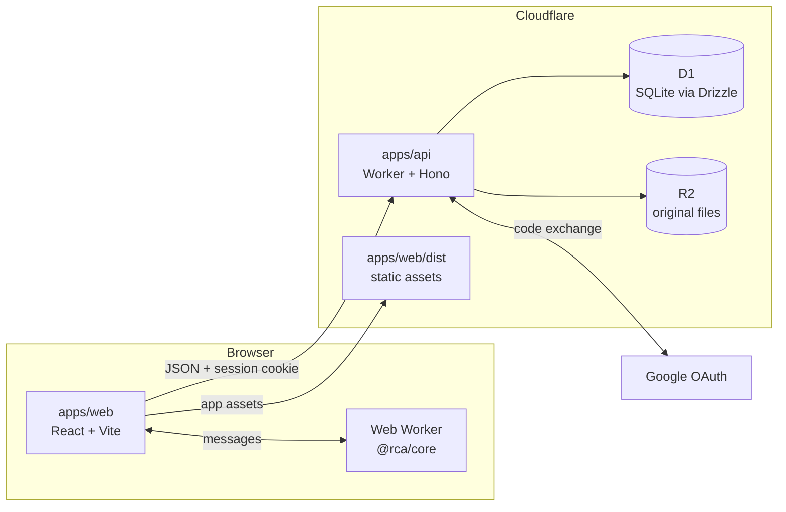

# Architecture

RunningCyclingAnalysis is browser-first with an optional account. The browser parses activity files
and runs the analysis. When a user signs in, the API stores per-activity digests in D1 and optional
original activity files (FIT, GPX or TCX) in R2. Without an account, the browser keeps the same
per-activity digests in its own IndexedDB storage (database `rca-device-library`), so a reload keeps
the results; nothing from them reaches the server. One Cloudflare Worker serves both the built web app
and the API.

This page describes the hardening branch's source. For what is deployed and when it was verified,
see the release state and live verification sections of [PRODUCTION.md](PRODUCTION.md).

## Components

| Part            | Package                       | Role                                                                                                                   |
| --------------- | ----------------------------- | ---------------------------------------------------------------------------------------------------------------------- |
| Analysis core   | `packages/core` (`@rca/core`) | Pure TypeScript, no DOM: FIT, GPX and TCX decoding, metabolic model, curves, heart-rate check, Monte Carlo comparison. |
| Web app         | `apps/web` (`@rca/web`)       | React UI. Parses and digests files in a Web Worker and combines digests for the profile view. Static build.            |
| Shared contract | `packages/contract`           | zod schemas for every request and response, imported by the API and the web app so the wire format has one definition. |
| API             | `apps/api` (`@rca/api`)       | Hono app on a Cloudflare Worker: Google sign-in, sessions, activity and file endpoints, account deletion.              |
| Database        | D1, accessed through Drizzle  | Users, OAuth identities, sessions, profiles, activity digests and the deployment-wide R2 budget ledger.                |
| File store      | R2                            | Original activity files, optional, one object per activity under a per-user prefix.                                    |

## Hosting

The app is deployed as a single Worker with Workers Static Assets, not as a Cloudflare Pages
project. `apps/api/wrangler.toml` points `[assets]` at `apps/web/dist`. Requests under `/api` run
the Worker first. Every other request is served from the built files when a file matches. A path that
matches no file falls through to the Worker, which returns a JSON 404 (plain text under `/assets/`).
The web app has no client-side routes and `not_found_handling = "none"`, so nothing falls back to
`index.html`. The web app and API therefore share
one origin, `https://rca-api.nutritioncoachapp.workers.dev`, so the session cookie is first-party
and `SameSite=Lax` applies. `npm run build` must run before a deploy, because the assets come from
the build output.

## Request flows

**Sign-in**

1. `GET /api/auth/google` creates a random `state` and PKCE verifier, keeps both in short-lived
   HttpOnly cookies, and redirects to Google's OAuth endpoint.
2. Google redirects to `GET /api/auth/google/callback`. The API checks `state`, exchanges the code
   with the verifier, and validates the returned ID token: audience, issuer, expiry, and
   `email_verified`. It uses the stable `sub` claim as the identity.
3. The API finds the user by that Google identity. If there is none, it links an existing account
   with the same verified email when that account has no Google identity yet, and otherwise creates
   the user. It issues a 256-bit session token, stores only its SHA-256 hash with an expiry, sets
   the token as a cookie, and redirects to `APP_URL`.

**Import** (parse, digest, upload)

1. A browser Web Worker parses the activity file with `@rca/core/import`, which picks FIT, GPX or
   TCX by extension, and computes the activity digest.
2. `POST /api/activities` sends metadata and digest as JSON. The API validates them against the
   contract schema, admits the row atomically against the per-account activity limit, inserts it,
   and returns its id.
3. If the user keeps the original, `PUT /api/activities/:id/file` reserves the bytes against the
   per-account quota and the deployment-wide R2 budget, streams the bytes to R2 under a per-user key
   prefix, and records the key and size on the row.

**View** (combine in the browser)

1. The web app calls `GET /api/activities` with optional `since`, `limit` and `cursor` query
   parameters. The page size is at most 90.
2. The API returns that user's digests only. The user id comes from the session, never from the
   request.
3. A browser Web Worker combines the digests with the profile settings (mass, priors) and runs the
   Monte Carlo comparison. The server does indexed D1 reads and sends each stored digest as it is,
   after checking only that it is JSON. The browser validates each digest and skips one that fails.
   The worker keeps the analysis of the last four periods, so going back to one is not worked out
   again until a digest or a mass changes.

**Other account routes**

- `POST /api/auth/logout` ends the current session.
- `GET /api/me` returns the signed-in user and profile. `PUT /api/profile` saves the profile.
- `DELETE /api/me` deletes the account (see Security).
- `GET /api/activities/:id/file` downloads an original, and `DELETE /api/activities/:id` removes an
  activity and its stored original.

## Data model

The tables below mirror `apps/api/src/db/schema.ts`. Wrangler also keeps a `d1_migrations` table
of applied migrations, and the migrations live in `apps/api/migrations`.

| Table                       | Columns                                                                                                                                                                        | Keys, constraints and notes                                                                                                                                                                                                                                                                                                                                                                                                                                 |
| --------------------------- | ------------------------------------------------------------------------------------------------------------------------------------------------------------------------------ | ----------------------------------------------------------------------------------------------------------------------------------------------------------------------------------------------------------------------------------------------------------------------------------------------------------------------------------------------------------------------------------------------------------------------------------------------------------- |
| `users`                     | `id`, `email`, `name`, `picture_url` (nullable), `created_at`, `activity_count`, `deleting_at`, `digest_bytes`, `file_bytes`, `list_cursor`                                    | Primary key `id`. `email` is unique. `activity_count` enforces the stored-activity limit; `digest_bytes` is the stored digest JSON total, capped per user; `file_bytes` is the sum of the user's `activities.file_size`, kept by triggers on `activities`, and the original-file quota reads it; `list_cursor` is the last library continuation cursor issued, spent once; `deleting_at` prevents new sign-ins or writes while account deletion is pending. |
| `oauth_accounts`            | `provider`, `provider_user_id`, `user_id`                                                                                                                                      | Primary key `(provider, provider_user_id)`. `user_id` references `users` with cascade delete. One Google identity per row.                                                                                                                                                                                                                                                                                                                                  |
| `sessions`                  | `id`, `user_id`, `expires_at`, `created_at`                                                                                                                                    | `id` is the SHA-256 hex of the session token; the token is never stored. `user_id` references `users` with cascade delete. `created_at` starts the absolute 90-day lifetime.                                                                                                                                                                                                                                                                                |
| `profiles`                  | `user_id`, `mass_kg`, `bike_mass_kg`, `units` (`imperial` or `metric`), `keep_files`, `birth_year` (nullable), `sex` (`female`, `male` or null), `updated_at`                  | Primary key `user_id`, which references `users` with cascade delete. `keep_files` says whether originals are retained. `birth_year` and `sex` are null until a rider sets them, and are used only for age grading; a `CHECK` limits `sex`.                                                                                                                                                                                                                  |
| `activities`                | `id`, `user_id`, `dedupe_key`, `sport` (`run` or `ride`), `start_ms`, `name`, `digest_version`, `digest_json`, `file_name`, `file_hash`, `file_key`, `file_size`, `created_at` | Primary key `id`. `user_id` references `users` with cascade delete. Unique `(user_id, dedupe_key)`. Indexes on `(user_id, start_ms)` and `(user_id, created_at)`. `file_key` and `file_size` are null when no original is stored.                                                                                                                                                                                                                           |
| `daily_budget`              | `user_id`, `day`, `action`, `used`                                                                                                                                             | Per-user, per-action UTC daily request counters; rows older than seven days are pruned.                                                                                                                                                                                                                                                                                                                                                                     |
| `upload_slots`              | `user_id`, `slot_id`, `expires_at`                                                                                                                                             | Leases that cap concurrent original-file uploads; expired slots are pruned by maintenance.                                                                                                                                                                                                                                                                                                                                                                  |
| `pending_account_deletions` | `user_id`, `requested_at`, `sweep_pending`                                                                                                                                     | Tombstones that block access and let interrupted file cleanup be retried. The row is removed after cleanup finishes.                                                                                                                                                                                                                                                                                                                                        |
| `r2_storage_budget`         | `id`, `lifetime_put_bytes`, `monthly_period`, `monthly_operations`, `monthly_put_bytes`, `orphan_sweep_cursor`, health-probe counters, `d1_size_bytes`                         | Single deployment-wide row for monthly R2 budgets, bounded deep-health probes and the orphan-sweep cursor. `d1_size_bytes` is the last-seen database size, which the database guard reads. The lifetime PUT field also enforces a nonrefundable 4 GiB write cap. See [PRODUCTION.md](PRODUCTION.md#request-isolation-and-limits).                                                                                                                           |

Every query on a user's data filters on `user_id`, which comes from the session. Deleting a user
cascades to `oauth_accounts`, `sessions`, `profiles` and `activities`.

## Import

Every activity file goes through the same path, whether it is dropped on the page or found inside a
Strava export zip. The stages are in the browser Web Worker, and none of them need the network.

1. **Archive extraction** (`extractFitFiles` in `packages/core/src/fit/archive.ts`). A source is
   one file, optionally gzipped, or a zip. Zips are streamed, and zips nested inside them are read
   up to two levels deep. Only `.fit`, `.gpx` and `.tcx` entries, each optionally `.gz`, are
   delivered. `.kml`, `.kmz`, `.pwx` and `.hrm` entries are counted and skipped. Skipped entries are
   drained, not buffered. Entry counts, entry sizes and total decompressed bytes are all capped, so
   an oversized archive stops with a reason instead of exhausting memory. When the export's activity
   list (step 7) names its activities, the zip's activity entries (those formats, and the ones skipped
   above) in a folder with no named file are drained and counted as not activities.
2. **Dispatch** (`parseActivityFile` in `packages/core/src/import/index.ts`). The extension, after
   any `.gz`, selects `parseFit`, `parseGpx` or `parseTcx`. Other names are refused. The bytes must
   already be decompressed.
3. **Shared pipeline** (`activitiesFromUnits` in `packages/core/src/import/pipeline.ts`). Each
   parser returns units: one per FIT session, one per GPX track and one per TCX activity. The
   pipeline drops impossible samples, such as speeds above the sport's maximum, and rejects
   activities that are shorter than a minute, longer than 48 hours or dated implausibly. A part is
   measured by the seconds its records cover: one second per record, plus each gap of up to 10 s
   (longer gaps are pauses), so "smart recording" passes in every format; it must also hold 60
   seconds that are not paused. A track whose points are mostly more than 10 s apart is refused as
   too sparse rather than as too short. A ride with no positions is indoor when it has no altitude,
   or when it has power, its altitude spans under 10 m and it is under 0.5 m/s for 95% of its
   recorded time. It splits a
   unit at gaps longer than four hours, resamples to 1 Hz, and applies one sample budget to the
   whole file.
4. **Streaming XML** (`scanXmlBytes` in `packages/core/src/xml/parse.ts`). The GPX and TCX parsers
   read a small strict XML scanner that emits events and builds no tree. Its memory follows the
   nesting depth, plus the decoded source text and the points of the track being read. Entity
   declarations are never expanded, so any entity other than the five predefined ones is an error.
5. **GPS helper** (`trackFromFixes` in `packages/core/src/import/gps.ts`). It turns positions into
   distance and speed. It drops invalid and duplicate-time fixes, and rejects fixes that imply more
   than twice the sport's maximum speed. Speed is a centred difference over 10 seconds either side
   of each fix. Distance is integrated over time, and a gap longer than 30 seconds credits no
   distance. GPX always uses it. TCX uses it for distance when a file has no `DistanceMeters`, and
   for speed when the file has neither device speed nor device distance.
6. **Near-duplicate rule** (`packages/core/src/duplicates.ts`). Two activities are near-duplicates when
   they have the same sport, start within 60 seconds of each other, and have durations within 10%
   or within 60 seconds of each other. Groups are transitive: if A matches B and B matches C, all
   three are one group. From a group, the copy from the richest format is kept: FIT, then TCX, then
   GPX. Within one format, the copy with a power meter is kept, then the copy with heart rate, then
   the longer duration. This preference applies to files analyzed together. A saved activity is tied
   to the hash of its original file, so replacing it with a different file requires deleting that
   activity and importing the preferred file again.
7. **Activity list** (`readActivityList` in `packages/core/src/import/activitiesCsv.ts`, and
   `packages/core/src/import/names.ts`). Before any file in a Strava export zip is parsed, the zip's
   `activities.csv` is read by range, from the top-level zip's central directory only, so it may sit
   anywhere in the zip. A zip nested inside the export is never searched for a list. Its `Filename`
   column names each activity file's path in the zip, without `.gz`, and its `Activity Name` and
   `Activity Type` columns say what the activity is called and what sport it was. The headers match
   in any case, and paths are compared lowercase, with forward slashes (a zip written with backslashes
   is read too) and no `.gz`, and with `.` and `..` segments and repeated slashes resolved. A row that
   climbs above the zip's root, or ends as a folder does (`.`, `..` or a closing slash), names no file.
   The list has at most 10,000 rows in all, and is limited to 32 MiB inflated. The cap
   is a memory budget: at the cap, reading the list uses about 100–150 MB at peak, holding its
   compressed bytes, its inflated bytes and their decoded text. Its inflated bytes count against the
   zip's decompressed-bytes budget, even when the list is malformed.
   The first row wins for a file that appears twice. A row with a file and no name is kept, since its
   type still says what the file is. A list that ends inside a quoted field is ignored, so it names
   no files.
   An activity file of that zip which the list does not name is not an activity when no file the list
   names sits in its folder or a folder above it: Strava's saved routes in `routes/`. It is not read,
   not counted in the progress total or as rejected, and not counted against the 10,000-file cap. The
   import reports it apart as `notActivities`. So does a `.kml`, `.kmz`, `.pwx` or `.hrm` file in such
   a folder, which is otherwise counted as a format the app does not read. A file the list does not
   name is still read when a named file sits beside it or above it, as a partial or edited list
   leaves it, and a named file at the zip's root covers every folder. Every row of the list names its
   folder, whether or not the zip holds that row's file.
   Nothing is left out when the list cannot be trusted to say what is an activity: there is no list,
   or it is malformed, names no file, or was cut at the row cap; the zip holds more than one
   `activities.csv`; or the list names none of the zip's activity files, as when they sit in a folder
   it does not expect or are spelled another way. Files inside a zip nested in the export, and single
   files, are never left out this way.
   A GPX track with no `<type>` or only a number the app does not know, and a TCX activity whose
   Sport is Other or missing, takes its sport from the `Activity Type` column: Run, Trail Run and
   Virtual Run are runs; Ride, Virtual Ride, Gravel Ride and Mountain Bike Ride are rides; Virtual Run
   and Virtual Ride are indoor; E-Bike Ride is refused. A sport the file names is never overridden,
   and a FIT file keeps its own. The one exception is an e-bike type (E-Bike Ride, E-Mountain Bike
   Ride), which refuses the file whatever sport it names. A sport that is refused is reported under
   the list's type, such as `Hike`, when the file gives none or gives only a number. A GPX file is
   checked for its sport before it is called empty, so a walk or a gym session with no points is
   reported as that sport. An empty run or ride stays empty.
   The refusal says `listed: true` when that name is the list's, so a page can show it as written; a
   name the file gives, such as a FIT sport, is not marked.
   An import counts files, not activities. `filesAdded` is the files with an activity that is in the
   library afterwards and shown, which is a workout the library did not hold or a held one whose save
   had failed and now succeeds, and not one hidden as a copy of another. Every other file read is one
   entry in `duplicates`: a copy of a held workout, the same file added again, a richer copy that
   replaces the held one, or a new activity hidden as a copy. So `filesAdded` is zero exactly when the
   import added no run or ride. `activities` still counts the activities, for the sentence that says
   what an import added. Every refused file is listed, two files of one name included, and `rejected`
   counts those and the unreadable formats. A file read cleanly takes back a refusal only of its own
   source under its name, or its name with `.gz`.
   A leg's name is the first of these that applies: the list's name, unless it is a device default
   such as `ACTIVE LOG`, a bare number or a date; the file's own title, which is a GPX track name; or
   a name made from the start time on the importing device's clock and the sport, such as
   `Morning Run`. The parts of the day are Night (0:00 to 4:59), Morning (5:00 to 10:59), Lunch
   (11:00 to 13:59), Afternoon (14:00 to 16:59), Evening (17:00 to 20:59) and Night (21:00 to 23:59).
   TCX has no title element, and its Notes are free text, so they are not used. When two activities
   of one file would share a name, each gets its start time: `Brick (Run, 6:11 am)`, or
   `Morning Run, 6:11 am`. Legs that still share a name, starting in the same minute, are numbered in
   file order, as in `Morning Run, 6:11 am (2)`. The name is saved with the activity when it is imported, so it does not
   change afterwards. Names apply only to newly imported activities. Existing library entries keep
   their names until they are deleted and imported again.

## Why the digest exists

A route shape (`packages/core/src/route/routeShape.ts`) is not part of the digest. It is an outline of
the GPS track with its position removed, and it stays on the device: beside the digest in the
device library, or in the worker's memory for an account. No request to the server or export carries it.

The comparison depends on settings (mass, efficiency and economy priors, period) and on the model
itself. Recomputing it from raw files on every view would mean parsing originals on every request,
which a free-tier Worker cannot afford. The browser therefore computes a digest once per file and
the server stores only that. A digest holds:

- **Best-effort curve**: mean-maximal power per sport for each duration in `DURATIONS_S`.
- **Heart-rate blocks**: all 5-minute blocks after the 10-minute warm-up. Critical-power selection
  happens at combine time, because the critical power depends on the merged curve.
- **Mass-free power terms and calibration sums**: the per-sample terms of the virtual-power model
  with mass and bike constants left out.
- **Run distance bests**: for runs only, the fastest wall-clock time over each distance in
  `RUN_RECORD_DISTANCES_M` (1 km, 1 mi, 5 km and 10 km). A window may not include a second the
  device did not record (a gap of over 10 s that no timer pause covers, where distance is held and
  time is unknown), an invalid motion sample, or a distance step above the top run speed. A timer
  pause is real time and counts. Grade does not matter here. It is absent for rides and for digests
  from before the field, and an empty list for a run under 1 km.
- **Splits** (runs only): each whole kilometre and mile, with its wall-clock seconds, flat-pace
  seconds (the flat time at the same metabolic cost, as the best efforts pace is), elevation gain and
  mean heart rate. A split with a boundary inside a gap the device did not record, where the distance is
  held and then stepped, has null seconds. The gaps are the resampler's `unrecorded` mask: a record gap
  over 10 s that no timer pause covers, in GPX, TCX and timer-less FIT alike. A split that only contains
  such a gap keeps its time, and takes the gap at the split's recorded effort, so its flat-pace time
  stays known.
  Digests made before splits were kept have none, and rides never do. Splits are stored in each digest
  and load with the library. They are kept out of activity summaries and SessionState, and the activity
  page reads them from the session on demand.

The virtual-power model is `P = (m (g_a + c_rr r) + CdA a) / η`, where `g_a = v (g sin θ + dv/dt)`,
`r = g v cos θ` and `a = ½ ρ v³`. The digest stores these per sample, so mass, rolling resistance,
CdA and efficiency are applied in the browser. The calibration sums hold the same terms in the form
needed to fit the bike model against power-meter rides, so it can be refitted without the files.

The trade-off: a model change that needs a per-sample quantity the digest does not hold requires
re-digesting the original. Each digest carries a `modelRevision` inside its JSON; this is separate
from the `digest_version` column, which remains the schema version. Digests at `MODEL_REVISION`
(currently 4, in `packages/core/src/digest/modelRevision.ts`) are analysed on their own, while older
digests are shown as outdated and excluded until the original activity file is re-imported. If its hash matches the stored activity, the API atomically replaces only the
derived digest and preserves the activity id, original-file metadata and quota reservation. Retained
R2 files can be downloaded by the browser to drive that recovery; no database migration is needed.

## Security

- **Sessions**: 256-bit random tokens signed with HMAC-SHA256 using required
  `SESSION_SIGNING_KEY`. A database leak does not expose live sessions, because only the token's
  SHA-256 hash is stored. Cookies are `HttpOnly`, `Secure` and `SameSite=Lax`. A session lasts
  30 days and is extended when it is used with less than 15 days left, but never beyond 90 days
  after it was created. Sign-out deletes the session row.
- **CSRF**: `SameSite=Lax` stops cross-site requests from carrying the cookie on unsafe methods.
  As a second layer, every non-GET `/api` request must send `X-RCA-Client: web`. A cross-site form
  cannot set that header, and a cross-origin fetch needs a CORS preflight that the API does not
  allow.
- **Sign-in**: the OAuth `state` and PKCE verifier protect against login CSRF and code injection.
  The redirect URI is fixed to `APP_URL` plus `/api/auth/google/callback`. Unverified Google emails
  are refused.
- **Per-user isolation**: the user id comes only from the session. Every query and R2 key is derived
  from it, and another user's record returns 404, so ids do not reveal what exists.
- **Input limits**: contract schemas validate every body and cap digest and upload sizes. Service
  limits are listed in [apps/api/LIMITS.md](../apps/api/LIMITS.md).
- **Files**: R2 objects have no public URLs. They are read only through the API, as attachments.
- **Account deletion**: `DELETE /api/me` writes a tombstone and marks the account as deleting first,
  which blocks sign-in and new writes. It then tries idempotent R2 sweeps around the D1 cascade. A
  failure leaves retry state; the caller can retry, and daily maintenance finishes pending work in
  bounded batches. Completion may be delayed when storage is unavailable or retries keep failing.
- **Secrets**: the Google client secret is a Worker secret, never in the repository.
- **Headers**: static files carry a Content Security Policy, `frame-ancestors 'none'`, COOP and CORP
  `same-origin`, `nosniff`, `no-referrer`, and HSTS. API responses are `no-store`. The details are
  in [PRODUCTION.md](PRODUCTION.md#security-headers-and-diagnostics).

## Limits

Service limits (per-account quotas, byte caps, edge rate limits and the deployment-wide R2 budget)
are listed in [apps/api/LIMITS.md](../apps/api/LIMITS.md). Analysis limits, meaning what the
statistics can and cannot show, are in the [README](../README.md#limits).

## Client bundle

The app has three main build outputs: the app entry, the analysis Web Worker (which runs `@rca/core`), and the stylesheet. Their sizes change with each build, so read them from the output of `npm run build -w @rca/web` rather than from this page.

The analysis runs in the Web Worker, so the worker bundle is the second download on a first visit.
The only third-party request the app makes is for a signed-in user's profile picture, from
`lh3.googleusercontent.com`.

## Cost model

Cloudflare's plans and limits can change. Check the current [Workers
pricing](https://developers.cloudflare.com/workers/platform/pricing/), [D1
pricing](https://developers.cloudflare.com/d1/platform/pricing/), and [R2
pricing](https://developers.cloudflare.com/r2/pricing/) before relying on a cost estimate.

| Service       | Pricing reference | What the app uses                                  |
| ------------- | ----------------- | -------------------------------------------------- |
| Static assets | Workers pricing   | The web app build, served by Workers Static Assets |
| Workers       | Workers pricing   | API calls and JSON responses; no analysis          |
| D1            | D1 pricing        | Users, sessions, profiles and activity digests     |
| R2            | R2 pricing        | Original files, only when a user keeps them        |

CPU time per request is the binding constraint. The open risk is `GET /api/activities` for a large
library, which sends hundreds of stored digests in one request. Measure it with a realistic library
before launch.

## Portability

- **Hono** handlers use fetch-style request and response objects, so the same app runs on Node,
  Bun or Deno with a different entry point. Only the bindings (D1, R2, secrets) change.
- **Drizzle** schemas are TypeScript. The SQLite dialect can move to Postgres
  (`drizzle-orm/pg-core`) with a Postgres driver, but migrations and column types need rewriting.
  The schema is not a drop-in.
- **R2** is S3-compatible for the operations used here. Putting storage behind a small interface
  (put, get, delete) lets S3 or MinIO replace it.
- **Auth** uses Web Crypto and `fetch` for the Google OAuth exchange and token checks, so it should
  run on any runtime that provides them.
- **Core and web app** have no Cloudflare dependency. The web app is static and can be hosted
  anywhere.
