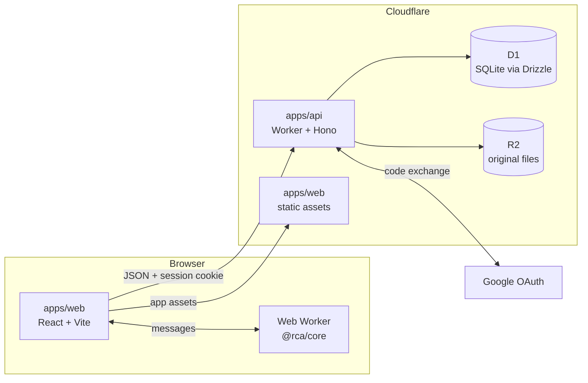

# Architecture

RunningCyclingAnalysis is browser-first with an optional account. The browser parses activity files
and runs the analysis. When a user signs in, the API stores per-activity digests in D1 and optional
original FIT files in R2. The API and built web app run on the same Cloudflare Worker.

## Components

| Part            | Package                       | Role                                                                                                                   |
| --------------- | ----------------------------- | ---------------------------------------------------------------------------------------------------------------------- |
| Analysis core   | `packages/core` (`@rca/core`) | Pure TypeScript, no DOM: FIT decoding, metabolic model, curves, heart-rate check, Monte Carlo comparison.              |
| Web app         | `apps/web` (`@rca/web`)       | React UI. Parses and digests files in a Web Worker and combines digests for the profile view. Static build.            |
| Shared contract | `packages/contract`           | zod schemas for every request and response, imported by the API and the web app so the wire format has one definition. |
| API             | `apps/api` (`@rca/api`)       | Hono app on a Cloudflare Worker: Google sign-in, sessions, activity and file endpoints, account deletion.              |
| Database        | D1, accessed through Drizzle  | Users, sessions, profiles and activity rows holding digests.                                                           |
| File store      | R2                            | Original FIT files, optional, one object per activity.                                                                 |

The web app and API share one origin. Cloudflare serves static files directly and runs the Worker
for `/api/*`, so the session cookie is first-party and `SameSite=Lax` applies.

## Request flows

**Sign-in**

1. `GET /api/auth/google` creates a random `state` and PKCE verifier, keeps both in short-lived
   HttpOnly cookies, and redirects to Google's OAuth endpoint.
2. Google redirects to `GET /api/auth/google/callback`. The API checks `state`, exchanges the code
   with the verifier, and validates the returned ID token claims, including the account's stable
   `sub` identifier.
3. The API creates the user on first sign-in, issues a 256-bit session token, stores only its
   SHA-256 hash with an expiry, sets the token as a cookie, and redirects back to the app.

**Import** (parse, digest, upload)

1. A browser Web Worker parses the FIT file with `@rca/core/fit` and computes the activity digest.
2. `POST /api/activities` sends metadata and digest as JSON. The API validates them against the
   contract schema, inserts the row, and returns its id.
3. If the user keeps the original, `PUT /api/activities/:id/file` streams the bytes to R2 under a
   per-user key prefix and records the key and size on the row.

**View** (combine in the browser)

1. The web app calls `GET /api/activities?since=...` for the selected period.
2. The API returns that user's digests only. The user id comes from the session, never from the
   request.
3. A browser Web Worker combines the digests with the profile settings (mass, priors) and runs the Monte
   Carlo comparison. The server does one indexed D1 read and serialises JSON.

## Data model

| Table        | Main columns                                                                                                 | Notes                                                                                                              |
| ------------ | ------------------------------------------------------------------------------------------------------------ | ------------------------------------------------------------------------------------------------------------------ |
| `users`      | `id`, `google_sub` (unique), `created_at`                                                                    | One row per Google account. Keyed by `sub`, not email, which can change.                                           |
| `sessions`   | `token_hash` (primary key), `user_id`, `expires_at`                                                          | The cookie holds the token. The database holds only its hash.                                                      |
| `profiles`   | `user_id` (primary key), `mass_kg`                                                                           | Settings applied when digests are combined. Age and sex arrive with population scoring.                            |
| `activities` | `id`, `user_id`, `sport`, `started_at`, `title`, `digest` (JSON), `digest_version`, `file_key`, `file_bytes` | Indexed on `(user_id, started_at)`. Every query filters on `user_id`. `file_key` is null when no original is kept. |

## Why the digest exists

The comparison depends on settings (mass, efficiency and economy priors, period) and on the model
itself. Recomputing it from raw files on every view would mean parsing originals on every request,
which a free-tier Worker cannot afford. The browser therefore computes a digest once per file and
the server stores only that. A digest holds:

- **Best-effort curve**: mean-maximal power per sport for each duration in `DURATIONS_S`.
- **Heart-rate blocks**: all 5-minute blocks after the 10-minute warm-up. Critical-power selection
  happens at combine time, because the critical power depends on the merged curve.
- **Mass-free power terms and calibration sums**: the per-sample terms of the virtual-power model
  with mass and bike constants left out.

The virtual-power model is `P = (m (g_a + c_rr r) + CdA a) / η`, where `g_a = v (g sin θ + dv/dt)`,
`r = g v cos θ` and `a = ½ ρ v³`. The digest stores these per sample, so mass, rolling resistance,
CdA and efficiency are applied in the browser. The calibration sums hold the same terms in the form
needed to fit the bike model against power-meter rides, so it can be refitted without the files.

The trade-off: a model change that needs a per-sample quantity the digest does not hold requires
re-digesting the original. Each digest carries a `modelRevision` inside its JSON; this is separate
from the `digest_version` column, which remains the schema version. Revision 2 digests are analysed
on their own, while older digests are shown as outdated and excluded until the original FIT file is
re-imported. If its hash matches the stored activity, the API atomically replaces only the derived
digest and preserves the activity id, original-file metadata and quota reservation. Retained R2
files can be downloaded by the browser to drive that recovery; no database migration is needed.

## Security

- **Sessions**: 256-bit random tokens. A database leak does not expose live sessions, because only
  the SHA-256 hash is stored. Cookies are `HttpOnly`, `Secure` and `SameSite=Lax`. Sign-out deletes
  the session row.
- **CSRF**: `SameSite=Lax` stops cross-site requests from carrying the cookie on unsafe methods.
  As a second layer, state-changing endpoints require a custom header. A cross-site form cannot set
  it, and a cross-origin fetch needs a CORS preflight that the API does not allow.
- **Sign-in**: the OAuth `state` and PKCE protect against login CSRF and code injection. Redirect
  URIs are fixed.
- **Per-user isolation**: the user id comes only from the session. Every query and R2 key is derived
  from it, and another user's record returns 404, so ids do not reveal what exists.
- **Input limits**: contract schemas validate every body and cap digest and upload sizes.
- **Files**: R2 objects have no public URLs. They are read only through the API.
- **Account deletion**: `DELETE /api/account` removes the user's R2 objects first, then the user row,
  which cascades to profiles, sessions and activities. If it fails part-way, the remaining rows can
  be deleted by a retry.
- **Secrets**: the Google client secret and any signing keys are Worker secrets, never in the repo.

## Cost model

Cloudflare's plans and limits can change. Check the current [Workers pricing](https://developers.cloudflare.com/workers/platform/pricing/),
[D1 pricing](https://developers.cloudflare.com/d1/platform/pricing/), and [R2 pricing](https://developers.cloudflare.com/r2/pricing/)
before relying on a cost estimate.

| Service       | Pricing reference | What the app uses                              |
| ------------- | ----------------- | ---------------------------------------------- |
| Static assets | Workers pricing   | The web app build                              |
| Workers       | Workers pricing   | API calls and JSON responses; no analysis      |
| D1            | D1 pricing        | Users, sessions, profiles and activity digests |
| R2            | R2 pricing        | Original files, only when a user keeps them    |

CPU time per request is the binding constraint. The open risk is `GET /api/activities` for a large
library, which serialises hundreds of digests in one request. Measure it with a realistic library
before launch.

## Portability

- **Hono** handlers use fetch-style request and response objects, so the same app runs on Node,
  Bun or Deno with a different entry point. Only the bindings (D1, R2, secrets) change.
- **Drizzle** schemas are TypeScript. The SQLite dialect can move to Postgres (`drizzle-orm/pg-core`)
  with a Postgres driver, but migrations and column types need rewriting. The schema is not a drop-in.
- **R2** is S3-compatible for the operations used here. Putting storage behind a small interface
  (put, get, delete) lets S3 or MinIO replace it.
- **Auth** uses Web Crypto and `fetch`, so it should run on any runtime that provides them.
- **Core and web app** have no Cloudflare dependency. The web app is static and can be hosted anywhere.
