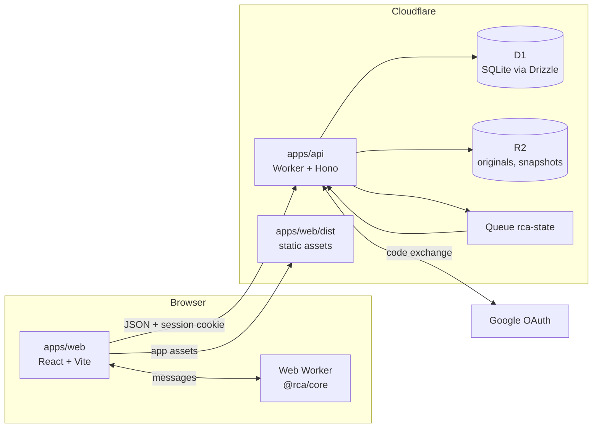

# Architecture

RunningCyclingAnalysis has two ways to run. Signed out, the browser parses files and runs the analysis,
and nothing leaves the device. Signed in, the server is the one authority for the account: it holds the
digests, computes the results and serves them from `GET /api/state`. The browser keeps a copy and draws it.
One Cloudflare Worker serves both the built web app and the API.

This page is a map: the parts, the flows, the stores and where each rule lives. It holds no edge-case
rules. Those sit in comments beside the code that enforces them, and in the design notes it links.
For what is deployed see [RELEASES.md](RELEASES.md); for how releases are verified see
[PRODUCTION.md](PRODUCTION.md); for planned work see [design/README.md](design/README.md).

## Parts

| Part            | Package                       | Role                                                                                                                            |
| --------------- | ----------------------------- | ------------------------------------------------------------------------------------------------------------------------------- |
| Analysis core   | `packages/core` (`@rca/core`) | Pure TypeScript, no DOM, no Cloudflare. Decodes FIT, GPX and TCX, builds digests, combines them into results.                   |
| Shared contract | `packages/contract`           | zod schemas for every request and response, and the account limits. The API and the web app import them: one wire format.       |
| API             | `apps/api` (`@rca/api`)       | Hono on a Cloudflare Worker: sign-in, sessions, activities, files, settings, lifts, `/api/state`, the queue consumer, the cron. |
| Web worker      | `apps/web/src/worker`         | Parses and digests files, holds the signed-out session, stores device data, sends account saves. Runs `@rca/core` off the page. |
| Web UI          | `apps/web/src/ui`, `src/api`  | React pages. Draws results from the worker (signed out) or from the `/api/state` copy (signed in). Static build.                |

**Core** (`packages/core/src`): `fit`, `gpx`, `tcx` and `xml` decode a file; `import` turns units into activities,
reads the Strava and Garmin export lists and names legs; `digest` builds the per-activity digest and declares model
revisions; `curves`, `records`, `splits`, `quality` and `metabolic` feed it; `session*` and `combine` merge digests
into results; `lookback`, `effort`, `workbench`, `route` and `lift` hold the features built on them. `duplicates.ts`
is the one near-duplicate rule. `digest/readDigest.ts` is the one reader of a stored digest.

**Hosting.** One Worker with Workers Static Assets, not Pages. `apps/api/wrangler.toml` points `[assets]` at
`apps/web/dist`; `/api` runs the Worker first, everything else is a built file or the built 404 page. The app uses
hash routes and one origin, so the session cookie is first-party. `npm run build` runs before every deploy.

## Flows

### Signed out: import and analysis

1. The page hands files to the worker. `extractFitFiles` streams a file or zip (`packages/core/src/fit/archive.ts`),
   `parseActivityFile` picks the parser, `activitiesFromUnits` builds activities, and `digestActivity` builds one
   digest per activity.
2. Export lists (`activities.csv`, the Garmin summaries) name and label activities before files are read.
3. The worker keeps digests in memory and in `rca-device-library`, with the name and SHA-256 of each file so a later
   sign-in can offer them to the account. `AnalysisSession` combines them, runs the Monte Carlo comparison and
   replies with a `SessionState`. Per-second traces go to `rca-workbench-evidence`. Routes stay on the device.
4. No request carries a digest, trace or route. The sample athlete takes the same path. Remove all empties it.

### Signed in: import and save

1. Files are parsed in the browser worker exactly as above, so the file itself never goes to the server for parsing.
   The import is checked against the account's held index (skip and duplicate rules), then saved.
2. `POST /api/activities` sends metadata and digest. The API validates it, admits the row against the account
   limits, inserts it and bumps `users.library_version`. `PUT /api/activities/:id/file` stores an original in R2 when
   the account keeps files. An import's saves run a few at a time within `worker/saveLimits.ts`.
3. Each digest is written to the `rca-outbox` first and removed once the server has it or refuses it. The outbox
   resumes in the tab that holds the account's writer lock.
4. Files dropped before `/api/me` answers are analysed on the device, then saved and dropped from local state once the
   account is known (`keepProvisional`). Device-kept digests are offered to the account by adoption.

### Signed in: compute on read and the queue

Design: [design/server-authority.md](design/server-authority.md), [design/server-compute.md](design/server-compute.md).

1. Every write that changes results raises `users.library_version` or `users.lift_revision` and enqueues a message
   on `rca-state`. The consumer (`apps/api/src/state`) reads the account's inputs, computes with `@rca/core`, gzips
   the `SessionState` snapshot to R2 and records it in `state_jobs`.
2. `GET /api/state` (`routes/state.ts`) serves the stored snapshot when `isCurrent` says it covers the library, the
   lift revision, the result revision and today's local day. Otherwise it computes in the request, stores and
   serves. The ETag is the snapshot hash, so an unchanged state is a 304.
3. One compute runs per isolate (a lock) and per account (`claim_until`). A request that loses either serves the
   stored snapshot, or answers `202 computing` when there is none. The read budget (`stateRead`, `routes/state.ts`): a 304 is
   free; a body costs one read unit, except a stored copy served while another compute runs; a compute is charged, and
   refunded when it fails or has nothing to store.
4. The browser reads only `/api/state` for an account, keeps the last answer in `rca-state`, and repaints when the ETag
   changes. Other tabs are told over `rca-sync-v1`. It builds no `SessionState` in account scope.
5. The browser also keeps an index of the account's activity records (listed from `GET /api/activities`, keyset
   paged). The index serves the import's duplicate check, the Library list, delete, rename, labels and export. It is
   not analysis.
6. Result revision, ordering and the cap on account size: `state/resultRevision.ts`, `state/record.ts`,
   `packages/contract/src/limits.ts`, `apps/api/LIMITS.md`.

### Garmin push

Design: [design/garmin-sync.md](design/garmin-sync.md). Switched off (`GARMIN_ENABLED`). The account links Garmin
through `/api/garmin/connect` and `/callback` (tokens are one AES-GCM ciphertext in `provider_links`). Garmin pushes
a new activity, the Worker records it in `inbox_items` and answers at once, and the queue consumer reads the file with
the same core parser, saves the digest through the same create path and deletes the file. The next open shows it from
`/api/state`. `DELETE /api/garmin` unlinks. `/api/garmin/deregistration` (Garmin's notice, exempt from `X-RCA-Client`) and account
deletion unlink and ask Garmin to stop. Only the link and
deregistration routes exist today; the push ingest is the design's next step.

### Sign-in and session

`GET /api/auth/google` sets `state` and PKCE cookies and redirects to Google. The callback checks both, validates the
ID token, finds, links or creates the user (closed unless the email is in `ALLOWED_EMAILS`) and sets a session cookie
whose token is stored only as a hash. A refused browser navigation redirects to `#/?signin=<code>`. Files:
`routes/auth.ts`, `auth/google.ts`, `auth/signIn.ts`, `auth/session.ts`, `auth/signupGate.ts`, `signInProblem.ts`.

### Account deletion

`DELETE /api/me` (`routes/me.ts`) calls `startAccountDeletion` (`accountDeletion.ts`): a tombstone and `deleting_at`
block sign-in and writes first. `finishAccountDeletion` then sweeps `users/{id}/` in R2 around the D1 cascade,
saves the day's counts under an HMAC of the Google subject (`identity_budget`) and asks Garmin to stop. An
interrupted sweep keeps its pending row and the daily maintenance finishes it. The browser forgets the account's
device data (`worker/forgetAccountDetails.ts`, `deleteAccountDetails.ts`, `sweepAccountDetails.ts`).

### Releases and the rollback floor

A release is built and gated in a clean worktree (`npm run verify:release`), then deployed from a local Wrangler
session, never from CI. Migrations apply before the new Worker. [RELEASES.md](RELEASES.md) is the ledger: commit, Worker
version, migrations and the rollback floor, the oldest Worker still safe to roll back to. The floor only moves
forward, when a release changes what an older Worker cannot read. `GET /api/health` reports the build `sha`, and
`npm run smoke:prod -- --expect-sha <sha>` checks it. Steps and guards: [PRODUCTION.md](PRODUCTION.md),
[DEPLOY.md](DEPLOY.md). Digest changes follow [ENGINEERING.md](ENGINEERING.md), "Changing the digest".

## Stores

### D1

The table below mirrors `apps/api/src/db/schema.ts`; `apps/api/src/architectureDoc.test.ts` fails when a table or
column differs. Migrations are in `apps/api/migrations`. Every query on a user's data filters on `user_id` from the
session. Deleting a user cascades to every table that references `users`.

| Table                       | Columns                                                                                                                                                                                                           | Holds                                               |
| --------------------------- | ----------------------------------------------------------------------------------------------------------------------------------------------------------------------------------------------------------------- | --------------------------------------------------- |
| `users`                     | `id`, `email`, `name`, `picture_url`, `created_at`, `activity_count`, `deleting_at`, `digest_bytes`, `file_bytes`, `list_cursor`, `lift_count`, `lift_revision`, `library_version`                                | The account and its counters                        |
| `oauth_accounts`            | `provider`, `provider_user_id`, `user_id`                                                                                                                                                                         | One Google identity per user                        |
| `sessions`                  | `id`, `user_id`, `expires_at`, `created_at`                                                                                                                                                                       | Session token hashes                                |
| `profiles`                  | `user_id`, `mass_kg`, `bike_mass_kg`, `units`, `keep_files`, `birth_year`, `sex`, `updated_at`                                                                                                                    | Profile and file-keeping choice                     |
| `athlete_measurements`      | `user_id`, `kind`, `sport`, `from_date`, `value`, `updated_at`                                                                                                                                                    | Dated mass, max heart rate, thresholds              |
| `athlete_settings`          | `user_id`, `keep_power`, `counted_runs`, `period`, `zone`, `updated_at`                                                                                                                                           | Choices the results depend on                       |
| `state_jobs`                | `user_id`, `computed_version`, `computed_at`, `snapshot_hash`, `snapshot_version`, `attempted_at`, `pending_until`, `analysis_revision`, `snapshot_lift_revision`, `snapshot_now_ms`, `claim_until`               | The state snapshot's bookkeeping                    |
| `lift_sets`                 | `user_id`, `date`, `exercise`, `equipment`, `set_order`, `reps`, `load_kg`, `rpe`, `warmup`, `time`, `time_precision`, `updated_at`                                                                               | Logged lift sets                                    |
| `activities`                | `id`, `user_id`, `dedupe_key`, `sport`, `start_ms`, `name`, `name_override`, `digest_version`, `digest_json`, `file_name`, `file_hash`, `file_key`, `file_size`, `file_reservation_token`, `created_at`, `source` | One row per activity: the digest and original's key |
| `provider_links`            | `user_id`, `provider`, `provider_user_id`, `token_ciphertext`, `key_id`, `scopes`, `linked_at`                                                                                                                    | Garmin link and encrypted tokens                    |
| `inbox_items`               | `id`, `user_id`, `provider`, `provider_activity_id`, `file_key`, `file_size`, `attempts`, `state`, `reason`, `received_at`                                                                                        | Pushed activities waiting to be read                |
| `daily_budget`              | `user_id`, `day`, `action`, `used`                                                                                                                                                                                | Per-user UTC daily counters                         |
| `upload_slots`              | `user_id`, `slot_id`, `expires_at`                                                                                                                                                                                | Leases that cap concurrent uploads                  |
| `pending_account_deletions` | `user_id`, `requested_at`, `sweep_pending`                                                                                                                                                                        | Deletions in progress                               |
| `identity_budget`           | `identity_key`, `day`, `action`, `used`                                                                                                                                                                           | A deleted account's counts, by HMAC of the identity |
| `account_tombstones`        | `user_id`, `deleted_at`                                                                                                                                                                                           | Deleted accounts, kept 100 days for restore replay  |
| `r2_storage_budget`         | `id`, `lifetime_put_bytes`, `monthly_period`, `monthly_operations`, `monthly_put_bytes`, `orphan_sweep_cursor`, `reconcile_cursor`, health-probe counters, `d1_size_bytes`                                        | One deployment-wide row: R2 budgets, cursors, size  |

### R2

One bucket, private, read only through the API as attachments. Every key is under `users/{userId}/`
(`apps/api/src/storage.ts`): the original file per activity, `state/{hash}.json.gz` for the account's snapshot
(`state/key.ts`) and `inbox/{itemId}` for a pushed file (`inbox/key.ts`). The account sweep and the orphan scan read
that prefix.

### IndexedDB

| Database                 | Holds                                                                    | Signed in                                                                        |
| ------------------------ | ------------------------------------------------------------------------ | -------------------------------------------------------------------------------- |
| `rca-state`              | The last `/api/state` answer per account, and the signed-out device copy | Cache of the server's snapshot                                                   |
| `rca-device-library`     | Signed-out digests, each with its file's name and hash                   | Read once by adoption                                                            |
| `rca-outbox`             | Digests waiting to be saved to an account                                | Goes in phase 2; adoption stays ([server-authority](design/server-authority.md)) |
| `rca-checkin`            | Files already read, the check-in baseline, what the athlete has seen     | Per-device baseline                                                              |
| `rca-workbench-evidence` | Per-second traces, a cache of originals under one shared budget          | Cache, never a result                                                            |
| `rca-lifts`              | The lift logger's rows. No grade is computed from it for an account      | Logger store                                                                     |
| `rca-import-meta`        | The last five import records per library                                 | Device only                                                                      |

Web Locks: `rca-flush-<userId>` (the writer lock for saves and the updater), `rca-lifts-flush` (lift sends) and
`rca-import-<id>` (one per running import, so another tab can tell it is still going). `BroadcastChannel` `rca-sync-v1`
carries only what changed, never data. The sign-in sweep (`worker/sweepAccountDetails.ts`) removes another account's
rows from a shared browser.

## Security

Sessions are 256-bit tokens stored as SHA-256 hashes in HttpOnly, Secure, SameSite=Lax cookies. Every non-GET `/api`
request needs `X-RCA-Client: web`. The user id comes only from the session, and another user's record answers 404.
Contract schemas bound every body. Static files carry a CSP, `frame-ancestors 'none'`, COOP, CORP and HSTS; API
answers are `no-store`. Secrets are Worker secrets. Details:
[PRODUCTION.md](PRODUCTION.md#security-headers-and-diagnostics), `apps/api/src/middleware.ts`, `auth/session.ts`.

## Where rules live

| Rule                                                               | Where                                                                                                                          |
| ------------------------------------------------------------------ | ------------------------------------------------------------------------------------------------------------------------------ |
| Wire format, account limits, quotas                                | `packages/contract/src`, `apps/api/LIMITS.md`                                                                                  |
| What a file, archive or digest may ask of the importer             | [LIMITS.md](LIMITS.md), `packages/core/src/import/limits.ts`, `digest/readLimits.ts`                                           |
| Archive extraction, sample cleaning, indoor rule, 1 Hz resampling  | `packages/core/src/fit/archive.ts`, `import/pipeline.ts`, `import/indoor.ts`, `import/gps.ts`                                  |
| Strava list and Garmin export readers, sport mapping, naming       | `import/activitiesCsv.ts`, `looseList.ts`, `sportType.ts`, `garminList.ts`, `names.ts`                                         |
| Near-duplicates, group deletion, originals kept for the shown copy | `packages/core/src/duplicates.ts`, `apps/web/src/worker/deferredOriginals.ts`, `worker/deleteGroup.ts`                         |
| What a digest holds, model revisions, mixing rules                 | `packages/core/src/digest/revisions.ts`, `digest/modelRevision.ts`, `types.ts`, [ENGINEERING.md](ENGINEERING.md)               |
| Formulas and model constants                                       | [design/model-ledger.md](design/model-ledger.md), [design/threshold.md](design/threshold.md), `packages/core/src/constants.ts` |
| Effort gate, look-back, check-in                                   | [design/effort-gate.md](design/effort-gate.md), `packages/core/src/effort`, `lookback`                                         |
| Result revision, snapshot ordering, compute lock, claim, budget    | [design/server-authority.md](design/server-authority.md), `apps/api/src/state`                                                 |
| Saves, outbox, adoption, writer lock, rate-limit waits             | `apps/web/src/worker/saveLimits.ts`, `outbox.ts`, `outboxResume.ts`, `adoption.ts`, `rateLimitRetry.ts`                        |
| Updater and digest rebuild                                         | `apps/web/src/worker/updater.ts`, `rebuild.ts`                                                                                 |
| Worker messages, watchdog, request timeouts                        | `apps/web/src/worker/protocol.ts`, `workerWire.ts`, `ui/analysis/requestWatch.ts`                                              |
| Device library epochs, several tabs                                | `worker/deviceLibrary.ts`, `ui/tabSync.ts`                                                                                     |
| Trace cache budget, ledger, tombstones                             | `apps/web/src/worker/workbenchSchema.ts`, `workbench.ts`                                                                       |
| Import record and the partial-import notice                        | `apps/web/src/ui/importManifest.ts`, `ui/analysis/importManifestHook.ts`                                                       |
| Table rules, counters, caps, retention                             | `apps/api/src/db/schema.ts`, `db/users.ts`                                                                                     |
| Sessions, sign-in, sign-up list, redirect codes                    | `apps/api/src/auth`, `signInProblem.ts`, [PRODUCTION.md](PRODUCTION.md)                                                        |
| Activity list paging, labels, rename, upgrade                      | `apps/api/src/routes/activities`                                                                                               |
| Account deletion                                                   | `apps/api/src/accountDeletion.ts`, `routes/me.ts`                                                                              |
| Bundle budgets, lazy pages                                         | `scripts/ops/check-bundle-size.mjs`, `apps/web/src/ui/lazyPages.ts`, `ui/analysis/workerStart.ts`                              |
| Portability (Hono, Drizzle, R2, Web Crypto)                        | `apps/api/src/index.ts`                                                                                                        |
| Copy, layout and the privacy page                                  | [DESIGN.md](DESIGN.md), the privacy page tests                                                                                 |
| Release steps, rollback floor, migrations                          | [PRODUCTION.md](PRODUCTION.md), [RELEASES.md](RELEASES.md)                                                                     |
| Plan, vision, review findings                                      | [ROADMAP.md](ROADMAP.md), [VISION.md](VISION.md), [REVIEWS.md](REVIEWS.md)                                                     |
